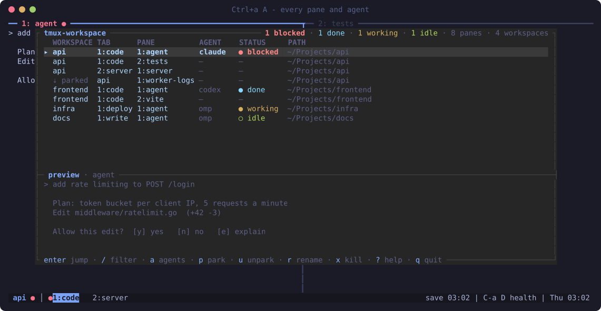
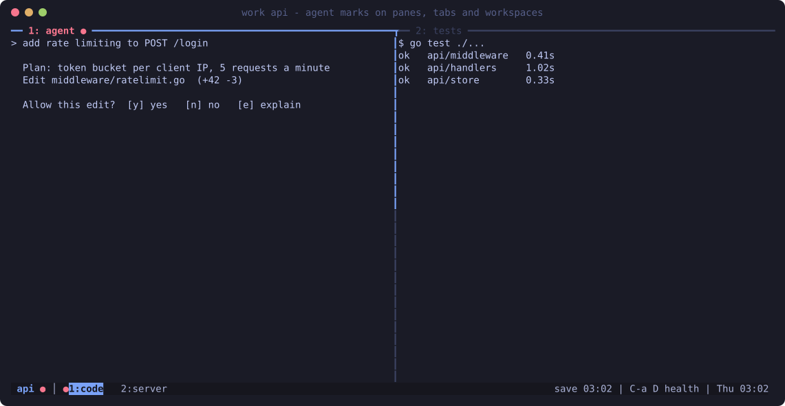
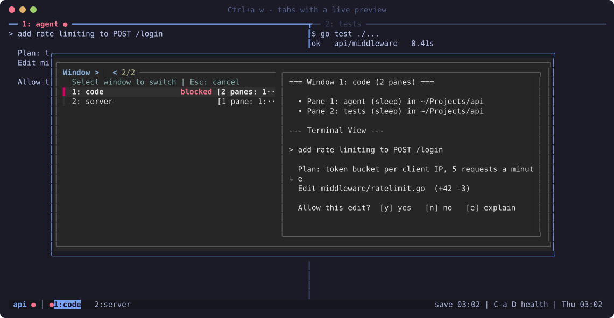

<div align="center">

# tmux-workspace

**Persistent tmux workspaces with live AI-agent status, a dashboard, and reboot recovery.**

[](https://github.com/ahmmkh/tmux-workspace/actions/workflows/ci.yml)
[](LICENSE)




</div>

You run coding agents in several projects at once: Claude Code in one, Codex in another, omp in a
third. tmux-workspace gives each project its own workspace, shows at a glance which agent needs
you, and brings everything back after a reboot.

## Features

- **A workspace per project.** `work api` opens `~/Projects/api` as a tmux session, creating the
  folder the first time. `Ctrl+a s` picks one with fuzzy search, most recent first, each with its agent status.
- **Live agent status.** Every pane, tab and workspace carries a mark: <code>●</code> blocked (needs
  you), <code>●</code> done (finished while you looked away), <code>●</code> working, <code>○</code> idle. A sound
  plays when an agent blocks or finishes.
- **Dashboard.** `Ctrl+a A` lists every pane of every workspace with its agent and status, and a
  preview. Jump, filter, park, rename or close from the keyboard.
- **Parking.** `Ctrl+a !` hides a pane while it keeps running; `Ctrl+a u` brings it back.
- **Reboot recovery.** A snapshot every 5 minutes. After a reboot, `work` rebuilds workspaces,
  tabs, layouts and labels, and reopens Claude Code, Codex, omp and Neovim sessions by their exact
  id, never a guess.
- **Clipboard everywhere.** Copy mode yanks to the system clipboard on macOS, Wayland and X11, and
  over SSH through OSC 52.

| Agent marks on panes, tabs and the workspace | Tabs with a live preview (`Ctrl+a w`) |
|---|---|
|  |  |

## Install

```sh
curl -fsSL https://raw.githubusercontent.com/ahmmkh/tmux-workspace/main/install.sh | bash
```

The installer clones into `~/.local/share/tmux-workspace`, checks for tmux 3.3+ and Python 3.9+,
links its files into `~/.local/bin` and `~/.config`, adds the `work` command to your shell, and asks
where you keep your projects. Every file it replaces is backed up, and running it again changes
nothing. Read [`install.sh`](install.sh) first if you prefer; it is one bash script.

Or from a clone, which then stays the live source:

```sh
git clone https://github.com/ahmmkh/tmux-workspace.git ~/Projects/tmux-workspace
~/Projects/tmux-workspace/install.sh
```

| Option | Effect |
|---|---|
| `--deps` | Install missing tmux, Python, fzf and zoxide with brew, apt, dnf, pacman, apk or zypper |
| `--projects DIR` | Use `DIR` as the projects folder without asking |
| `--agents` | Also register the Claude Code, Codex, omp and Neovim integrations |
| `--yes` | Replace an existing `~/.tmux.conf` (it is backed up first) |
| `--no-shell`, `--no-tmux-conf` | Leave your shell startup files, or `~/.tmux.conf`, alone |
| `--dry-run` | Print what would change and change nothing |
| `--uninstall` | Remove the links and the shell lines, and restore the backups |

tmux-workspace is a complete tmux configuration with `Ctrl+a` as the prefix. If you already have a
`~/.tmux.conf`, the installer asks before replacing it, and `--uninstall` puts yours back.

### Requirements

tmux 3.3 or newer and Python 3.9 or newer. fzf and zoxide are recommended; sesh and lazygit are
optional. CI installs and tests on every platform below.

| Platform | Command |
|---|---|
| macOS | `brew install tmux fzf zoxide` |
| Debian 12, Ubuntu 24.04 | `sudo apt-get install tmux python3 fzf zoxide` |
| Fedora | `sudo dnf install tmux python3 fzf zoxide` |
| Arch | `sudo pacman -S tmux python fzf zoxide` |
| Alpine | `sudo apk add bash tmux python3 fzf zoxide` |

Ubuntu 22.04 ships tmux 3.2, which is too old. Any login shell works in panes (zsh, bash, fish, nu,
xonsh, …); tmux-workspace runs its own commands with `/bin/sh`. Set `TMUX_WORKSPACE_SHELL` to use a
different shell in panes than your login shell.

## Quick start

```sh
work my-project      # open or create a workspace in your projects folder
```

Then press `Ctrl+a`, release, and press:

| Key | Action |
|---|---|
| `A` | Dashboard of every pane and agent |
| `s` / `Tab` | Pick a workspace / go back to the previous one |
| `c`, `w` | New tab, pick a tab |
| <code>&#124;</code>, `-` | Split side by side, split top and bottom |
| `?` | Every shortcut, searchable |
| `D` | Health check: terminal, hooks, autosave |

## Key bindings

The prefix is `Ctrl+a`. Movement and resize keys repeat without pressing the prefix again.

| Area | Keys |
|---|---|
| Workspaces | `s` pick, `Tab` previous, `X` close, `$` rename, `W` tree of everything |
| Tabs | `c` new, `w` pick, `1`–`9` go to, `n`/`p` next/previous, `<`/`>` move, `,` rename |
| Panes | <code>&#124;</code> `%` `-` `"` split, `h` `j` `k` `l` move, `H` `J` `K` `L` resize, `z` zoom, `t` label, `x` close, `Space` layouts, `y` type into all |
| Agents | `A` dashboard, `M` sounds on/off, `a` AI tools (optional) |
| Parking | `!` park, `u`/`b` bring back right/below, `U`/`B` choose one |
| Recovery | `Ctrl+s` save now, `Ctrl+r` restore missing workspaces, `P` saved scrollback |
| Copy mode | `Enter` or `[` start, `v`/`V`/`Ctrl+v` select, `y` copy, `]` paste, `/` search |
| Tools | `g` lazygit, `e` scratch shell, `D` doctor, `C` clean up idle panes, `r` reload |

[WORKSPACE_GUIDE.md](WORKSPACE_GUIDE.md) explains every feature in depth.

## Agent integrations

Each agent reports its own status through its hooks. Nothing stores your prompts or terminal output.

| Agent | What `install.sh --agents` registers |
|---|---|
| Claude Code | Hooks and a status line in `~/.claude/settings.json` (an existing status line is kept) |
| Codex | Hooks in `~/.codex/hooks.json`; review them with `/hooks` in Codex |
| omp | The extension `~/.omp/agent/extensions/tmux-workspace.ts` |
| Neovim | `lua/custom/tmux_workspace.lua`; add `require('custom.tmux_workspace').setup()` to `init.lua` |

Only agents you have installed are touched, your other hooks stay, and every file is backed up
first. Restart running agents afterwards.

## Configuration

`~/.config/tmux-workspace/config.json`:

```json
{
  "projects_dir": "~/Projects",
  "model": "",
  "doppler": null
}
```

| Key | Meaning |
|---|---|
| `projects_dir` | Where `work NAME` opens and creates folders. `tmux-workspace setup` changes it; `TMUX_WORKSPACE_PROJECTS` overrides it. |
| `model` | The model for the optional AI tools on `Ctrl+a a`: a Jev model on OpenRouter (`typesafe/jev-…`). Empty turns them off. |
| `doppler` | Optional `{"project", "config", "scope"}` to fetch `OPENROUTER_API_KEY` with Doppler; otherwise set the variable. |

Snapshots and backups live in `~/.local/state/tmux-workspace`, readable only by you.

## Uninstall

```sh
~/.local/share/tmux-workspace/install.sh --uninstall    # or install.sh --uninstall in your clone
```

It removes the links, the shell lines and any agent integrations, and restores what the installer
replaced. A running tmux server stops starting panes through tmux-workspace; restart it to finish.
Your snapshots and `~/.config/tmux-workspace` stay.

## Troubleshooting

- **Something looks wrong:** run `tmux-workspace doctor` (or `Ctrl+a D`). It checks the tmux
  version, the links, the clipboard and sound tools, the hooks and the last autosave.
- **Marks show as `_`:** your locale is not UTF-8. Set `LANG=en_US.UTF-8` (or `C.UTF-8`).
- **Copy does not reach the clipboard on Linux:** install `wl-clipboard` (Wayland) or `xclip`
  (X11). Over SSH, your terminal must allow OSC 52.
- **No sound on Linux:** install PipeWire (`pw-play`) or PulseAudio (`paplay`) and the freedesktop
  sound theme. `Ctrl+a M` mutes sounds.
- **Your old `~/.tmux.conf` is still active:** the installer kept it. Rerun with `--yes`.

## Contributing

```sh
make lint test        # shellcheck, Python 3.9 compatibility, unit and tmux tests
make test-install     # install in Ubuntu, Debian, Fedora, Arch and Alpine containers (Docker)
make screenshots      # rebuild docs/images from a demo server
```

Tests never touch your tmux server: each one runs on its own socket with a temporary state
directory. Python is standard library only, and the installer runs on bash 3.2.

## License

[MIT](LICENSE)
