<div align="center">

# tmux-workspace

**Persistent tmux workspaces with live AI-agent status, a dashboard, and reboot recovery.**

[](https://github.com/ahmmkh/tmux-workspace/actions/workflows/ci.yml)
[](LICENSE)


</div>

You run coding agents in several projects at once: Claude Code in one, Codex in another, omp in a
third. tmux-workspace gives each project its own workspace, shows at a glance which agent needs
you, and brings everything back after a reboot.

## Features

- **A workspace per project.** `work api` opens `~/Projects/api` as a tmux session, creating the
  folder the first time. `Ctrl+a s` picks one with fuzzy search, most recent first, each with its agent status.
- **Live agent status.** Every pane, tab and workspace carries a mark: <code>●</code> blocked (needs
  you), <code>●</code> done (finished while you looked away), <code>●</code> working, <code>○</code> idle. A sound
  plays when an agent blocks or finishes.
- **Dashboard.** `Ctrl+a A` lists every pane of every workspace with its agent and status, and a
  preview. Jump, filter, park, rename or close from the keyboard.
- **Parking.** `Ctrl+a !` hides a pane while it keeps running; `Ctrl+a u` brings it back.
- **Reboot recovery.** A snapshot every 5 minutes. After a reboot, `work` rebuilds workspaces,
  tabs, layouts and labels, and reopens Claude Code, Codex, omp and Neovim sessions by their exact
  id, never a guess.
- **Clipboard everywhere.** Copy mode yanks to the system clipboard on macOS, Wayland and X11, and
  over SSH through OSC 52.

| Agent marks on panes, tabs and the workspace | Tabs with a live preview (`Ctrl+a w`) |
|---|---|
|  |  |

## Install

```sh
curl -fsSL https://raw.githubusercontent.com/ahmmkh/tmux-workspace/main/install.sh | bash
```



The installer downloads the release archive for your machine and checks it against the release's
`SHA256SUMS` before it writes anything: if the checksum differs, it stops and installs nothing. In a
terminal it then asks what to set up:

```text
tmux-workspace 2.1.0 installer
macOS 27 arm64 · zsh · brew · found: tmux 3.5a, git, python3 3.13

What should I set up?   ↑↓ move · space toggle · enter install · q quit

Needed for tmux-workspace to work
  [■] tmux-workspace        ~/.local/bin/tmux-workspace
  [■] tmux config           ~/.tmux.conf (yours moves to a backup)
  [■] work command          ~/.zshrc
Recommended
› [x] fzf                   fuzzy pickers · brew install fzf
  [x] zoxide                `work` finds folders you visit often · brew install zoxide
  [x] Claude Code status    found ~/.claude
  [x] Codex status          found ~/.codex
  [x] iTerm2 profile        a "tmux workspace" profile
Optional
  [ ] lazygit               Ctrl+a g popup · brew install lazygit
  [ ] sesh                  picker fallback · brew install sesh
The agent rows go on and off together.

Projects folder [~/Projects]: ~/code
  ✓ fzf                   brew install fzf
  ✓ zoxide                brew install zoxide
  ✓ unpack                tmux-workspace 2.1.0 to ~/.local/share/tmux-workspace
  ✓ tmux-workspace        ~/.local/bin/tmux-workspace
  …
```

The needed rows are always set up (tmux too, with your package manager, when it is missing or older
than 3.3); recommended rows start ticked, optional ones do not, and what you have already is on the
`found` line. `q` quits without changing anything. Then the installer unpacks the release to
`~/.local/share/tmux-workspace/<version>` (`current` there points at the version in use), links
`tmux-workspace`, `tw-clip` and `tw-sound` into `~/.local/bin`, `agent-status.conf` into
`~/.config/tmux-workspace` and `tmux.conf` to `~/.tmux.conf`, adds the `work` command to your shell,
and sets the projects folder. Every file it replaces is backed up, and running it again changes
nothing. Read [`install.sh`](install.sh) first if you prefer; it is one bash script.

What the commands print goes to `~/.local/state/tmux-workspace/install.log`. When a step fails, the
installer shows the end of that log, what to do, and a link to a new GitHub issue with your system and
the end of the log filled in: your home folder, user and host names, e-mail and IP addresses and
anything that looks like a token are taken out first, and nothing is sent until you open the link and
submit it. The checklist is only for a run without options in a terminal. With any of `--deps`,
`--projects`, `--agents`, `--no-shell`, `--no-tmux-conf`, `--yes` or `--dry-run`, or without a terminal
(a script, CI), there is none: the options decide, and the output is the plain one line per change it
always was.

Releases are built for macOS (Apple silicon and Intel) and Linux (x86_64 and arm64). The Linux
binaries are static, so any distribution works. Options go after `bash -s --`, and `--version` picks a
release other than the latest:

```sh
curl -fsSL https://raw.githubusercontent.com/ahmmkh/tmux-workspace/main/install.sh | bash -s -- --version v2.1.0 --agents
```

`readlink ~/.local/share/tmux-workspace/current` names the installed version. On any other platform
the installer stops with `no prebuilt binary for <os>/<arch>` (exit status 3); build from a clone, as
below.

| Option | Effect |
|---|---|
| `--deps` | Install missing tmux, fzf and zoxide with brew, apt, dnf, pacman, apk or zypper |
| `--projects DIR` | Use `DIR` as the projects folder without asking |
| `--agents` | Also register the Claude Code, Codex, omp and Neovim integrations |
| `--version vX.Y.Z` | Install that release instead of the latest (release installs) |
| `--yes` | Replace an existing `~/.tmux.conf` (it is backed up first) |
| `--no-shell`, `--no-tmux-conf` | Leave your shell startup files, or `~/.tmux.conf`, alone |
| `--dry-run` | Print what would change and change nothing |
| `--update`, `--check` | Update, or only say whether there is an update; `work update` runs these |
| `--uninstall` | Remove the links and the shell lines, and restore the backups |

tmux-workspace is a complete tmux configuration with `Ctrl+a` as the prefix. If you already have a
`~/.tmux.conf`, the checklist says it moves to a backup (without the checklist, the installer asks
first, and `--yes` replaces it), and `--uninstall` puts yours back.

### From a clone

```sh
git clone https://github.com/ahmmkh/tmux-workspace.git ~/Projects/tmux-workspace
~/Projects/tmux-workspace/install.sh
```

The installer builds the binary with `cargo build --release --locked` (Rust 1.89 or newer from
[rustup.rs](https://rustup.rs), and a C compiler, because SQLite is compiled in), puts it at
`bin/tmux-workspace` in the clone (git ignores it) and links everything from the clone, which then
stays the live source. Without cargo it downloads the release for the version in `Cargo.toml` and
checks it the same way. After a `git pull`, run `./install.sh` again, because tmux starts that binary
in every new pane; `work update` pulls and installs the new binary in one step.

### Requirements

tmux 3.3 or newer. fzf (0.38 or newer) and zoxide are recommended; sesh and lazygit are optional.
The installer itself needs bash, curl or wget, tar, and `sha256sum` or `shasum`. CI installs and
tests on every platform below.

| Platform | Command |
|---|---|
| macOS | `brew install tmux fzf zoxide` |
| Debian 12, Ubuntu 24.04 | `sudo apt-get install tmux fzf zoxide` |
| Fedora | `sudo dnf install tmux fzf zoxide` |
| Arch | `sudo pacman -S tmux fzf zoxide` |
| Alpine | `sudo apk add bash tmux fzf zoxide procps` |

On Alpine, agent status and snapshots need procps: they read processes with its `ps`, and BusyBox's
lacks the options they use. `install.sh --deps` installs it.

**Python 3.9 or newer** is needed only for the dashboard (`Ctrl+a A`), the AI tools (`Ctrl+a a`) and
the clean-up (`Ctrl+a C`), until they are ported to Rust. Without it the installer warns, everything
else works, and those three commands say `needs python3 3.9+ until it is ported`.

Ubuntu 22.04 ships tmux 3.2, which is too old. Any login shell works in panes (zsh, bash, fish, nu,
xonsh, …); tmux-workspace runs its own commands with `/bin/sh`. Set `TMUX_WORKSPACE_SHELL` to use a
different shell in panes than your login shell.

## Quick start

```sh
work my-project      # open or create a workspace in your projects folder
```

Then press `Ctrl+a`, release, and press:

| Key | Action |
|---|---|
| `A` | Dashboard of every pane and agent |
| `s` / `Tab` | Pick a workspace / go back to the previous one |
| `c`, `w` | New tab, pick a tab |
| <code>&#124;</code>, `-` | Split side by side, split top and bottom |
| `?` | Every shortcut, searchable |
| `D` | Health check: terminal, hooks, autosave |

## Key bindings

The prefix is `Ctrl+a`. Movement and resize keys repeat without pressing the prefix again.

| Area | Keys |
|---|---|
| Workspaces | `s` pick, `Tab` previous, `X` close, `$` rename, `W` tree of everything |
| Tabs | `c` new, `w` pick, `1`–`9` go to, `n`/`p` next/previous, `<`/`>` move, `,` rename |
| Panes | <code>&#124;</code> `%` `-` `"` split, `h` `j` `k` `l` move, `H` `J` `K` `L` resize, `z` zoom, `t` label, `x` close, `Space` layouts, `y` type into all |
| Agents | `A` dashboard, `M` sounds on/off, `a` AI tools (optional) |
| Parking | `!` park, `u`/`b` bring back right/below, `U`/`B` choose one |
| Recovery | `Ctrl+s` save now, `Ctrl+r` restore missing workspaces, `P` saved scrollback |
| Copy mode | `Enter` or `[` start, `v`/`V`/`Ctrl+v` select, `y` copy, `]` paste, `/` search |
| Tools | `g` lazygit, `e` scratch shell, `D` doctor, `C` clean up idle panes, `r` reload |

[WORKSPACE_GUIDE.md](WORKSPACE_GUIDE.md) explains every feature in depth.

## Agent integrations

Each agent reports its own status through its hooks. Nothing stores your prompts or terminal output.

| Agent | What `install.sh --agents` registers |
|---|---|
| Claude Code | Hooks and a status line in `~/.claude/settings.json` (an existing status line is kept) |
| Codex | Hooks in `~/.codex/hooks.json`; review them with `/hooks` in Codex |
| omp | The extension `~/.omp/agent/extensions/tmux-workspace.ts` |
| Neovim | `lua/custom/tmux_workspace.lua`; add `require('custom.tmux_workspace').setup()` to `init.lua` |

The hooks run `tmux-workspace agent-hook`, which finds `tmux` and `lsof` on your `PATH`. Only
agents you have installed are touched, your other hooks stay, and every file is backed up first.
Restart running agents afterwards. `tmux-workspace integrations install|uninstall|status` does what
`install.sh --agents` and `--uninstall` do for them.

## Performance

The paths that run all the time are a Rust binary. Python spends about 37 ms starting before it does
anything, and a new pane, a Claude Code tool call and the status line each wait for that. `make bench`
times them against the Python of v1, which stays in `legacy/` for the purpose: hyperfine, 30 runs
after 3 warm-ups, the mean, on a scratch tmux server with 5 panes in 2 sessions.

| Path | Runs when | v1 (Python) | 2.0 (Rust) | Target |
|---|---|---|---|---|
| Agent hook with nothing to do | every Claude Code tool call | 37.5 ms | 1.8 ms | ≤ 5 ms |
| `pane-start` until it hands over to your shell | every new pane and tab | 52.9 ms | 6.6 ms | ≤ 15 ms |
| `agent-hook claude-status` | every refresh of Claude's status line | 58.7 ms | 14.9 ms | ≤ 20 ms |
| `help` | `Ctrl+a ?` | 37.8 ms | 1.8 ms | ≤ 5 ms |
| `save`, 5 panes | autosave every 5 minutes, `Ctrl+a Ctrl+s` | 304.3 ms | 32.3 ms | ≤ 60 ms |

Measured on an Apple M4 Pro, macOS 27.2, tmux 3.8, Python 3.15.2, hyperfine 2.0.0. What is left of
a path is mostly other programs: here a tmux call costs about 4 ms, a `ps` of one process about
1 ms, and a `ps` that lists the processes of the panes about 10 ms. So the binary batches its calls
and asks for little: a save of five panes makes 9 tmux calls and 2 `ps` calls, and lists the
processes on the ttys of the panes and the applications they record, not every process on the machine.
`make bench` needs [hyperfine](https://github.com/sharkdp/hyperfine); CI prints the numbers of a
shared Linux runner on every run, for information only.

## Configuration

`~/.config/tmux-workspace/config.json`:

```json
{
  "projects_dir": "~/Projects",
  "model": "",
  "doppler": null
}
```

| Key | Meaning |
|---|---|
| `projects_dir` | Where `work NAME` opens and creates folders. `tmux-workspace setup` changes it; `TMUX_WORKSPACE_PROJECTS` overrides it. |
| `model` | The model for the optional AI tools on `Ctrl+a a`: a Jev model on OpenRouter (`typesafe/jev-…`). Empty turns them off. |
| `doppler` | Optional `{"project", "config", "scope"}` to fetch `OPENROUTER_API_KEY` with Doppler; otherwise set the variable. |

Snapshots and backups live in `~/.local/state/tmux-workspace`, readable only by you.

## Update

```sh
work update            # or: tmux-workspace update
work update --check    # only say whether there is a newer release
```

An install from a release downloads the newer one, checks it against the release's `SHA256SUMS`,
and keeps the choices you made: the shell lines and `~/.tmux.conf` stay as they are, the agent
integrations are registered again if you had them, and the version before stays next to it. A clone
updates with a fast-forward `git pull` and builds or downloads the new binary first; it leaves a
clone with local changes, or on another branch than the default, alone. Nothing checks for updates in
the background. A workspace named `update` opens with `work ./update`.

## Uninstall

How you uninstall depends on how you installed:

```sh
~/.local/share/tmux-workspace/current/install.sh --uninstall    # a release install
~/.local/share/tmux-workspace/install.sh --uninstall            # a 1.x install that the one-line command upgraded in place
./install.sh --uninstall                                        # in the clone you made yourself
```

A release install has a `current` link in `~/.local/share/tmux-workspace`. A 1.x install made with
the one-line command is a git clone in that same folder, and stays one after you run the command
again: it has a `.git`, no `current`, and `install.sh` directly in it. For either, rerunning the
one-line command with `bash -s -- --uninstall` finds the installer in that folder for you.

It removes the links, the shell lines and any agent integrations, and restores what the installer
replaced. A running tmux server stops starting panes through tmux-workspace; restart it to finish.
Your snapshots and `~/.config/tmux-workspace` stay, and so does the folder `~/.local/share/tmux-workspace`
(the program files of a release, or the clone): delete it to remove them.

## Troubleshooting

- **Something looks wrong:** run `tmux-workspace doctor` (or `Ctrl+a D`). It checks the tmux
  version, the links, the clipboard and sound tools, the hooks and the last autosave.
- **Marks show as `_`:** your locale is not UTF-8. Set `LANG=en_US.UTF-8` (or `C.UTF-8`).
- **On tmux 3.3, save, park and the pickers fail with `A workspace name or directory contains
  unsupported control characters`:** the tmux server started without a UTF-8 locale, and then tmux
  3.3 prints the field separator of its formats as `_`. Set `LANG=C.UTF-8` (or `en_US.UTF-8`) in
  your shell profile, then restart tmux (`tmux kill-server`) from a new shell.
- **Copy does not reach the clipboard on Linux:** install `wl-clipboard` (Wayland) or `xclip`
  (X11). Over SSH, your terminal must allow OSC 52.
- **No sound on Linux:** install PipeWire (`pw-play`) or PulseAudio (`paplay`) and the freedesktop
  sound theme. `Ctrl+a M` mutes sounds.
- **Your old `~/.tmux.conf` is still active:** the installer kept it. Rerun with `--yes`.
- **`Ctrl+a A`, `a` or `C` say `needs python3 3.9+`:** the dashboard, the AI tools and the clean-up
  still run on Python. Install Python 3.9 or newer; nothing else needs it.
- **`doctor` says `tmux-workspace on PATH` is not the installed binary:** another copy comes first
  on your `PATH`. Remove it, or put `~/.local/bin` first.
- **New panes do not start your shell after a `git pull` of a clone:** `bin/tmux-workspace` is built,
  not pulled. Run `./install.sh` in the clone.

## Contributing

```sh
make lint test        # shellcheck, clippy, rustfmt, actionlint (when installed), a Python 3.9 compile check; the cargo tests, then the Python tests
make bench            # time the hot paths against the Python of v1 (needs hyperfine)
make test-install     # install in Ubuntu, Debian, Fedora, Arch and Alpine containers (Docker)
make dist             # build the release archive of this machine into dist/
make screenshots      # rebuild docs/images, including the first-run animation, from a demo server
```

Tests never touch your tmux server: each one runs on its own socket with a temporary state
directory. The core is Rust (`src/`, one binary, no dependencies besides `serde_json`, `libc` and
`rusqlite`). `legacy/` holds the Python that the dashboard, the AI tools and the clean-up still run;
it is standard library only. The installer runs on bash 3.2. Cutting a release and reading the
install and traffic numbers are in [docs/RELEASING.md](docs/RELEASING.md).

## Reporting a bug or an idea

```sh
work bug       # also Ctrl+a F in tmux
work idea
work bug --print
```

`work bug` builds a report of your setup, what `doctor` found and the last failures of tmux-workspace, shows
it in full, and asks before it opens GitHub's issue form with the report filled in. You read the form and
press Submit; nothing is sent before that. Names of workspaces, tabs and pane labels, folders, user and host
names, e-mail and IP addresses, keys and passwords in URLs are replaced or removed, and pane contents,
environment variables, shell history and git remotes are never in the report. Over SSH it prints the link and copies the report
with `tw-clip` instead. The [guide](WORKSPACE_GUIDE.md#reporting-a-bug-or-an-idea) lists everything the
report holds.

## License

[MIT](LICENSE)
